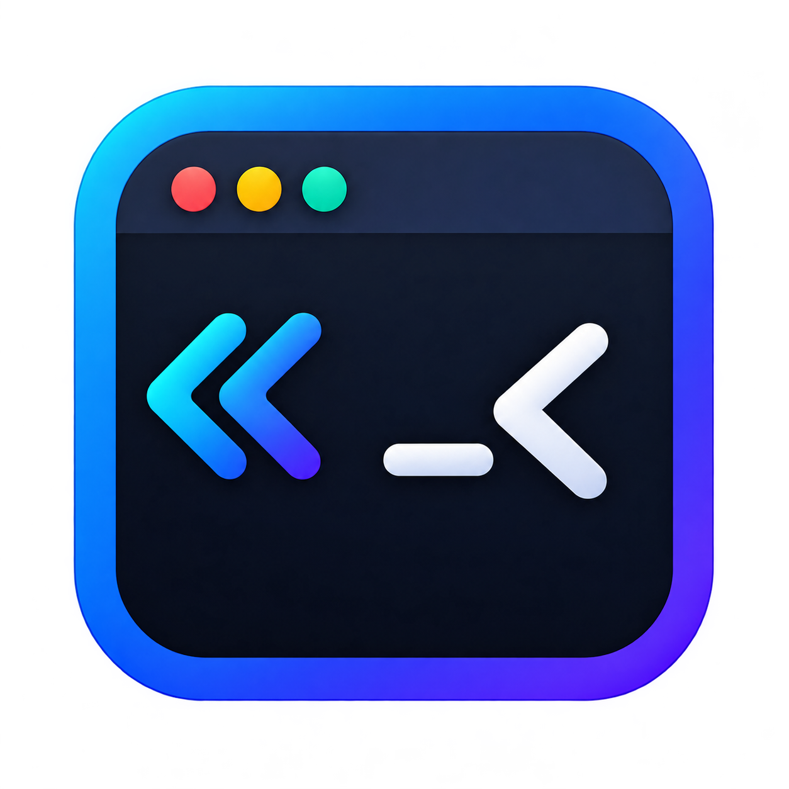

<div align="center">
  

  # Rtl Terminal for macOS

  **ترمینال مک با پشتیبانی از فارسی، عربی و نمایش راست به چپ**

  **A macOS terminal emulator with Persian, Arabic and right-to-left text support**

  **Amin Taghikhani**

  [فارسی](#فارسی) · [English](#english)
</div>

این پروژه نسخه macOS برنامه [Rtl Terminal](https://github.com/mirbehnam/RtlTerminal) است. منطق اصلی نسخه ویندوز (مدل صفحه VT، الگوریتم Smart RTL و چیدمان سطرها) به Swift منتقل شده و رابط کاربری با AppKit و CoreText و PTY خود macOS بازنویسی شده است.

---

## فارسی

### امکانات

- **Smart RTL**: سطرهای دارای متن فارسی یا عربی راست چین می شوند و کلمات انگلیسی، عددها، مسیرها (مثل `/usr/local/bin`) و گزینه ها (مثل `--version`) ترتیب خودشان را حفظ می کنند.
- **Row RTL**: راست به چپ کردن اجباری کل سطر، حتی در برنامه های تمام صفحه (پیش فرض خاموش).
- حروف فارسی و عربی همیشه به هم متصل نمایش داده می شوند (شکل دهی با CoreText).
- امکان انتخاب **فونت جداگانه برای متن راست به چپ** (مثلا Vazirmatn) در کنار فونت monospace ترمینال.
- رنگ های ANSI، رنگ های روشن، dim، ۲۵۶ رنگ و RGB؛ bold، italic، underline و strikethrough.
- اجرای برنامه های تعاملی و TUI (مثل vim، htop، Claude Code، Codex، OpenCode) با پشتیبانی از alternate screen، bracketed paste، گزارش ماوس SGR، focus reporting و synchronized output.
- رسم دقیق کاراکترهای جعبه ای و بلوکی، بدون فاصله بین خانه ها.
- زبانه های بومی macOS (`⌘T`) که در همان پوشه زبانه فعلی باز می شوند.
- کپی و چسباندن با `⌘C` و `⌘V`؛ فایل های کپی شده به صورت مسیر و تصویرهای کلیپ بورد به صورت مسیر یک فایل PNG چسبانده می شوند (مناسب ابزارهای هوش مصنوعی خط فرمان).
- رهاکردن فایل روی ترمینال، مسیر آن را تایپ می کند.
- تشخیص لینک ها و بازکردن آن ها با `⌘ + کلیک`.
- میانبرهای Ctrl با چیدمان فارسی صفحه کلید هم کار می کنند (مثلا `⌃C` وقتی زبان صفحه کلید فارسی است).
- تم تیره، روشن یا هماهنگ با سیستم.
- تاریخچه ۲۰۰۰، ۵۰۰۰ یا ۱۰۰۰۰ خطی؛ پاک کردن تاریخچه با `⌘K`.
- خروجی گرفتن از محتوای جلسه در یک فایل متنی UTF-8 (`⌘S`).
- فهرست ده پوشه اخیر در منوی Shell.
- بازکردن ترمینال در یک پوشه از Finder (منوی Services) یا با انداختن پوشه روی آیکون Dock.
- راهنمای داخلی به انگلیسی، فارسی و عربی.

### پیش نیازها

- macOS 12 (Monterey) یا جدیدتر، روی Apple Silicon یا Intel
- Xcode یا Command Line Tools با Swift 5.9 یا جدیدتر (`xcode-select --install`)

### ساخت و نصب

```bash
git clone <this-repository> RtlTerminal-mac
cd RtlTerminal-mac
./scripts/build-app.sh
cp -R dist/RtlTerminal.app /Applications/
```

اسکریپت، فایل `dist/RtlTerminal.app` و نسخه های `zip` و `dmg` آن را می سازد. برای ساخت نسخه universal (هم Apple Silicon و هم Intel) که به Xcode کامل نیاز دارد:

```bash
UNIVERSAL=1 ./scripts/build-app.sh
```

برنامه با امضای ad-hoc ساخته می شود. اگر فایل را از اینترنت دانلود کرده اید و macOS اجازه بازکردن نمی دهد، یک بار روی برنامه راست کلیک کرده و Open را بزنید، یا:

```bash
xattr -dr com.apple.quarantine /Applications/RtlTerminal.app
```

برای اجرای سریع بدون ساخت `.app`:

```bash
swift run RtlTerminal
```

### میانبرها

| کار | میانبر |
|---|---|
| زبانه جدید در پوشه فعلی | `⌘T` |
| پنجره جدید | `⌘N` |
| بستن زبانه | `⌘W` |
| زبانه قبلی و بعدی | `⇧⌘[` و `⇧⌘]` یا `⌃Tab` |
| کپی و چسباندن | `⌘C` و `⌘V` |
| انتخاب همه | `⌘A` |
| متوقف کردن فرمان | `⌃C` |
| پاک کردن تاریخچه | `⌘K` |
| خروجی گرفتن از جلسه | `⌘S` |
| Smart RTL | `⇧⌘R` |
| Row RTL | `⌥⌘R` |
| بزرگ و کوچک کردن فونت | `⌘+` و `⌘-` و `⌘0` |
| بازکردن لینک | `⌘ + کلیک` |
| انتخاب متن در برنامه هایی که ماوس را می گیرند | نگه داشتن `Shift` |
| تنظیمات | `⌘,` |

### بازکردن از Finder

بعد از کپی برنامه در `/Applications` و یک بار اجرای آن، در Finder روی یک پوشه راست کلیک کنید و از **Services** گزینه **New RtlTerminal Tab at Folder** را انتخاب کنید. اگر این گزینه دیده نمی شود، آن را در System Settings › Keyboard › Keyboard Shortcuts › Services فعال کنید. انداختن پوشه روی آیکون برنامه در Dock هم ترمینال را در همان پوشه باز می کند.

### تفاوت با نسخه ویندوز

- به جای ConPTY از PTY خود macOS استفاده می شود و shell پیش فرض، login shell کاربر (معمولا zsh) است.
- میانبرها مطابق عادت macOS هستند (`⌘C` برای کپی و `⌃C` برای توقف).
- راست کلیک منوی Copy و Paste را باز می کند.
- به جای منوی راست کلیک ویندوز، از Services در Finder استفاده می شود.
- بررسی خودکار به روزرسانی از GitHub Releases در این نسخه وجود ندارد.

---

## English

### Features

- **Smart RTL** right-aligns lines containing Persian or Arabic while English words, numbers, paths (`/usr/local/bin`) and options (`--version`) keep their own order.
- **Row RTL** forces right-to-left rows, including in full-screen applications (off by default).
- Persian and Arabic letters are always shaped and joined (CoreText), and fitted to their terminal cells.
- Optional **separate font for right-to-left words** (e.g. Vazirmatn) next to the monospaced terminal font.
- ANSI, bright, dim, 256 and RGB colors; bold, italic, underline and strikethrough.
- Interactive CLI/TUI applications with alternate screen, bracketed paste, SGR mouse reporting, focus reporting and synchronized output.
- Box-drawing and block characters drawn geometrically so they join seamlessly.
- Native macOS window tabs (`⌘T`) that open in the current tab's folder.
- `⌘C` / `⌘V`; copied files paste as quoted paths and clipboard images as the path of a PNG file.
- Dropping files on the terminal types their paths.
- Link detection; `⌘`-click opens links.
- Ctrl shortcuts work while a Persian or Arabic keyboard layout is active.
- Dark, light or system theme. Light mode adapts the 16 ANSI colors only.
- 2,000 / 5,000 / 10,000-line history; `⌘K` clears it.
- Export the session to a UTF-8 text file (`⌘S`).
- Ten most recent directories in the Shell menu.
- Open a terminal at a folder from Finder › Services, or by dropping the folder on the Dock icon.
- Built-in guide in English, Persian and Arabic.

### Requirements

- macOS 12 Monterey or later (Apple Silicon or Intel)
- Xcode or the Command Line Tools with Swift 5.9+

### Build

```bash
./scripts/build-app.sh                 # dist/RtlTerminal.app, .zip and .dmg
UNIVERSAL=1 ./scripts/build-app.sh     # arm64 + x86_64 (requires full Xcode)
swift run RtlTerminal                  # run without bundling
swift test                             # unit tests (Swift Testing; Swift 6 toolchain, works with Command Line Tools)
```

The app is ad-hoc signed. Set `SIGN_IDENTITY="Developer ID Application: …"` to sign for distribution. The GitHub workflow in `.github/workflows/macos.yml` tests, builds a universal app and attaches it to a release when a `v*` tag is pushed.

### Project layout

| Path | Contents |
|---|---|
| `Sources/RtlTerminalCore` | Platform-independent core: VT/xterm parser and screen buffer, Smart RTL, row layout, key encoding, link detection, themes |
| `Sources/RtlTerminal` | AppKit app: PTY session, CoreText renderer, windows/tabs, menus, settings, guide |
| `Tests/RtlTerminalCoreTests` | Unit tests, including ports of the Windows version's buffer regressions |

### Known limitations

- Smart RTL uses directional spans, not the full Unicode bidi algorithm (same as the Windows version).
- Only SGR (1006) mouse reporting is implemented.
- No automatic update check.

### Credits and license

Developed by **Amin Taghikhani**. Based on [Rtl Terminal](https://github.com/mirbehnam/RtlTerminal) by behnamapps (behnam tajadini). MIT License, see [LICENSE](LICENSE).
